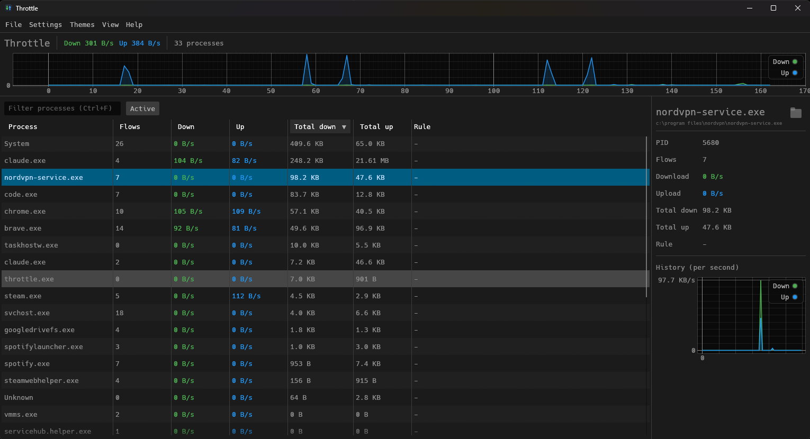
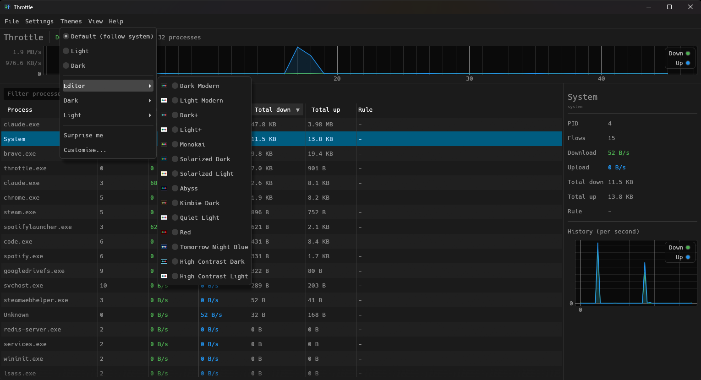
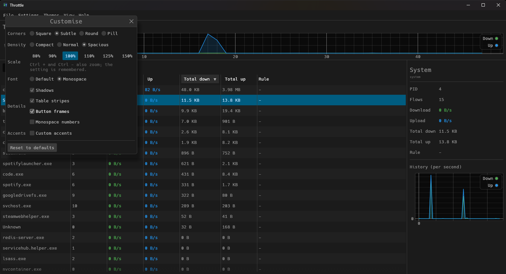
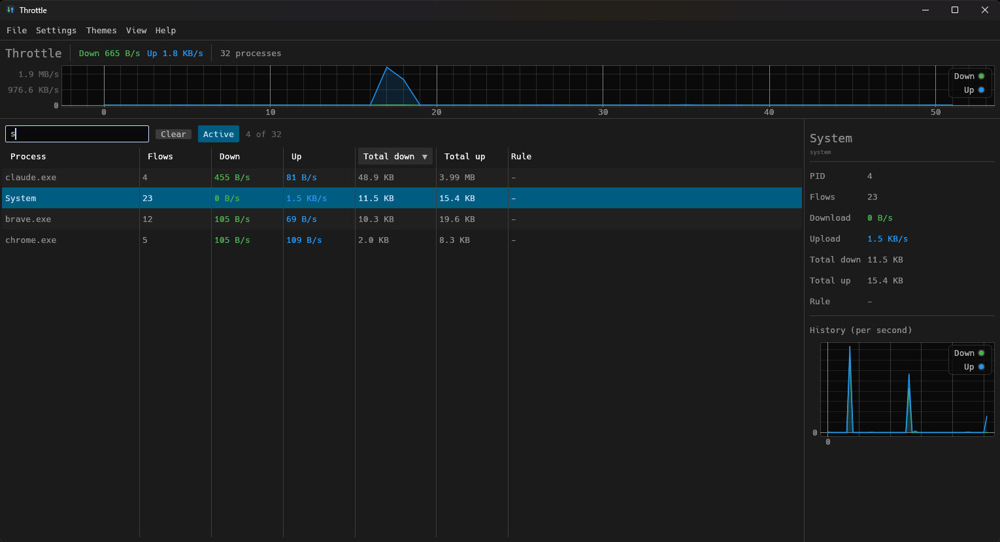

# Throttle
[](https://github.com/FrancescoCoding/Throttle/releases)


[](https://buymeacoffee.com/franwbu)


A free, open-source **NetLimiter-style bandwidth monitor and limiter for Windows**,
written in Rust. It shows live per-process download/upload rates and lets you cap
or block any process's network traffic, with no license nags and no telemetry.

## What it is

Throttle watches every network flow on your machine, attributes it to the
owning process, and optionally shapes it:

- **Live monitoring:** per-process download and upload rates, totals, and active
  flow counts, refreshed about once a second.
- **Per-process limits:** cap a process's download and/or upload speed
  (for example, hold a game updater to 2 MB/s).
- **Blocking:** drop all traffic for a process entirely.
- **Persistent rules:** rules are matched by executable path, so they survive
  restarts and re-apply automatically when the process launches again.

Traffic interception uses [WinDivert](https://reqrypt.org/windivert.html), a
signed, well-established user-mode packet-diversion driver, so Throttle does not
need its own kernel driver.

https://github.com/user-attachments/assets/9413bec4-a48a-41c2-9e75-7e6207d80d4f

## Features

- Native GUI (egui/eframe): sortable process table, total-traffic graph, and a
  per-process history sparkline.
- Humanized rates and totals (B/s, KB/s, MB/s, GB/s, base 1024).
- Right-click any process to set a download limit, set an upload limit, block,
  unblock, or remove its rule.
- Rate editor uses a number field plus a unit dropdown (B/s, KB/s, MB/s, GB/s).
- System tray icon, with optional minimise to tray, close to tray, start
  minimised, and launch at Windows startup (Settings menu). Startup uses a
  Task Scheduler logon task, since Windows skips Run-key entries that need
  elevation.
- Optional colour themes (Themes menu): editor and community palettes, import
  of any editor colour theme JSON, Customise (corners, density, scale, fonts,
  accents) and View (columns, plot, always on top, compact). Stock by default.
- Filter box above the table (Ctrl+F) and an Active chip that hides idle
  processes. The window size and position, panel
  sizes, column widths and sort order are remembered across restarts.
- Plot navigation: scroll zooms the time axis, drag pans it, double click
  resets the view.
- Rules can be switched off and back on without losing them, from the
  right-click menu or the tray menu, which lists every rule with a check
  mark. The tray tooltip shows the live download and upload totals.
- Runs as a single elevated process; engine and GUI communicate over channels.

## Screenshots

Live rates per process, with the selected process on the right and a button
that opens its folder:



The Themes menu, with editor and community palettes:



Customise: corners, density, scale, fonts and accents:



The filter box and the Active chip narrow the table to what matters:



## Download

Prebuilt Windows binaries are available on the
[Releases page](https://github.com/FrancescoCoding/Throttle/releases).
Grab the latest `Throttle-vX.Y.Z-windows-x64.zip`, extract it anywhere, and run
`throttle.exe`. The WinDivert driver files are included in the zip, so no extra
setup is needed. Windows will show a UAC prompt because the app needs
administrator rights (see below).

## Building

You need a recent stable Rust toolchain (2024 edition) and the WinDivert files
vendored in this repo under `vendor/WinDivert-2.2.2-A/x64`.

```powershell
# From the repository root:
cargo build --release
```

The build links against WinDivert using the import library at
`vendor/WinDivert-2.2.2-A/x64` (wired up via `WINDIVERT_PATH` in
`.cargo/config.toml`), and embeds a `requireAdministrator` manifest through the
`embed-manifest` build script.

### Running

WinDivert is loaded dynamically at runtime. Copy its two runtime files next to
the built executable before running:

```powershell
copy vendor\WinDivert-2.2.2-A\x64\WinDivert.dll   target\release\
copy vendor\WinDivert-2.2.2-A\x64\WinDivert64.sys target\release\
```

Then launch it:

```powershell
target\release\throttle.exe
```

## Administrator requirement

Throttle must run as Administrator, because WinDivert can only open its device
from an elevated process. The embedded manifest requests elevation, so Windows
shows a UAC prompt on launch. If the backend can't start (not elevated, or the
WinDivert files are missing), the app opens a small window explaining the error
instead of exiting silently.

## Antivirus note

WinDivert is a legitimate packet-capture driver, but because it is also used by
some game "boosters" and, occasionally, by malware, a few antivirus products
flag it heuristically. The files vendored here come from the official signed
WinDivert 2.2.2 release. If your AV quarantines `WinDivert64.sys` or
`WinDivert.dll`, verify them against the official distribution at
<https://reqrypt.org/windivert.html> and allow-list them if you trust the source.

## VPNs and web-filtering proxies

Some security products (for example NordVPN Threat Protection) intercept
browser connections and route them through a local proxy on the same machine.
While such a feature is active, the proxy process is the one talking to the
internet, so Throttle shows the browser's traffic under the proxy's process
(such as `nordsec-threatprotection-service`) and a limit set on the browser
itself has no effect; set it on the proxy process instead. Throttle does not
capture loopback traffic, so the interception itself keeps working.

## Support

Throttle is free, with no ads and no telemetry, and is built in my spare time.
If it saved you some frustration, you can
[buy me a coffee](https://buymeacoffee.com/franwbu). Stars, bug reports and
pull requests are just as welcome.

## License

- Throttle's own source code is licensed under the MIT License (see `LICENSE`).
- WinDivert (`WinDivert.dll`, `WinDivert64.sys`, headers/import lib) is a
  separate project licensed under the **LGPL v3** (with a GPL/proprietary dual
  option). Throttle links to it dynamically and ships it as a separate,
  replaceable DLL/driver; it is not statically linked into the binary. See
  `vendor/WinDivert-2.2.2-A/LICENSE` for the full text and terms.

The MIT code and the LGPL WinDivert component stay independently licensed.
Replacing the bundled WinDivert files with your own build is supported.
